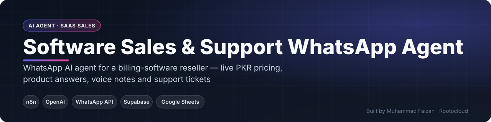
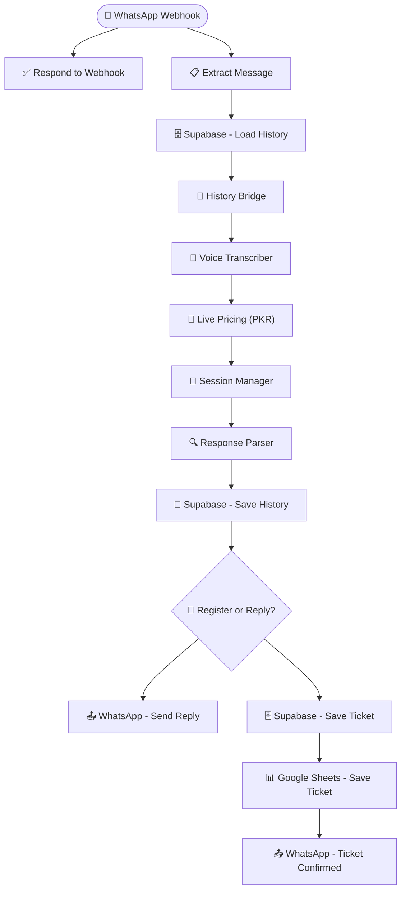

 

    

 

**[Get this built for your business](https://www.fiverr.com/faizan_develope) · [Rootocloud](https://rootocloud.com) · [More projects](https://github.com/MuhammadFaizan73)**

---

## 📌 Overview

A WhatsApp assistant for a billing-software reseller. It answers product and plan questions, converts plan prices to PKR using live exchange rates, understands voice notes, and registers support tickets with confirmation back to the customer.

## ✨ What It Does

- Live currency conversion for plan pricing
- Voice-note understanding (Whisper)
- Product and plan Q&A with conversation memory
- Support tickets → Supabase + Google Sheets
- Instant WhatsApp ticket confirmation

## 📈 Business Impact

Leads get accurate local pricing instantly and support requests are logged without manual entry.

## 🔀 How It Works

The diagram below is generated directly from the production n8n workflow.

### Workflow — 15 nodes

<!-- SCREENSHOTS -->
<!-- /SCREENSHOTS -->

## 🔒 About the Workflow File

This automation was built for a client, so the n8n workflow JSON (with prompts, credentials and business logic) is kept private.
**I can build a version tailored to your business** — [contact me on Fiverr](https://www.fiverr.com/faizan_develope) or [email](mailto:faizan.developer9200@gmail.com).

## 👨‍💻 Author

**Muhammad Faizan** — Founder, [Rootocloud](https://rootocloud.com) · n8n & AI Automation Specialist (8+ years)

© Muhammad Faizan. All rights reserved.

